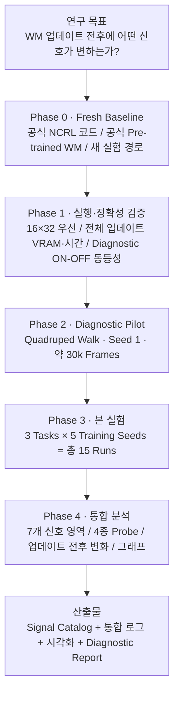
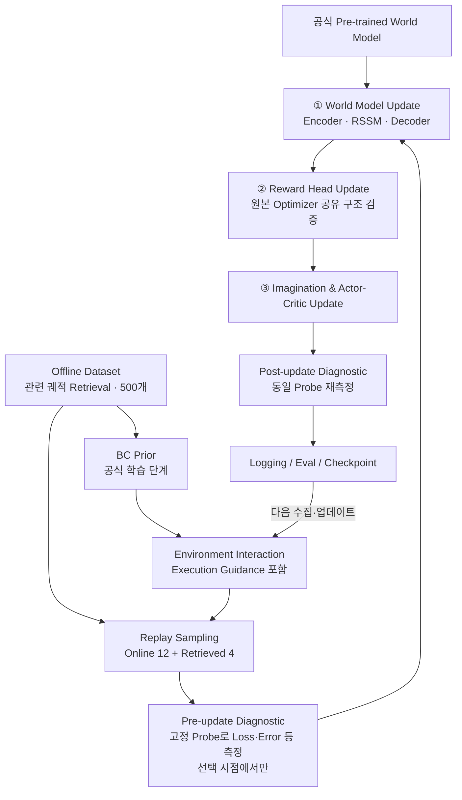
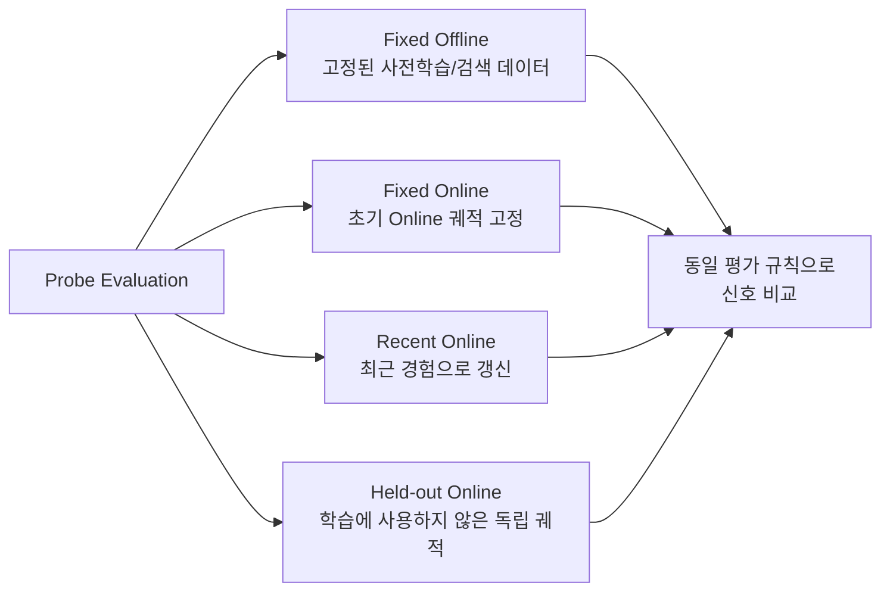
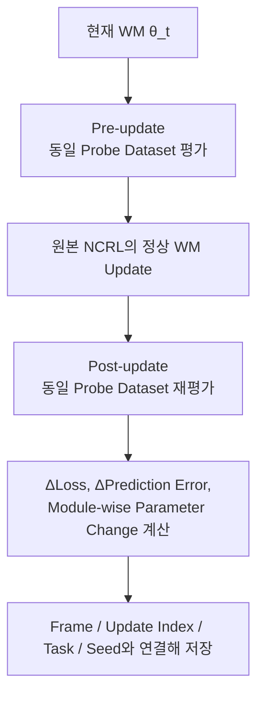
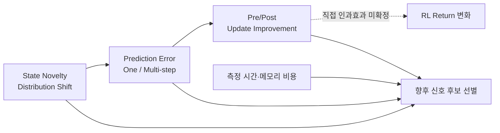

# NCRL World Model Update Dynamics — 실험 체계도

> **목적:** 원본 NCRL의 Full World Model Update 학습을 유지하면서, WM의 학습 상태·예측 품질·데이터 분포·파라미터 변화·Imagination·RL 성능·계산 비용을 폭넓게 측정한다. 이를 통해 **언제, 어떤 상황에서 WM 업데이트가 유용해 보이는지** 분석하고, 향후 Adaptive Update 연구를 위한 신호 후보를 발굴한다.
>
> **이번 실험에서 하지 않는 것:** Adaptive Update 구현, Update Skip, Every4/Every8 비교, 임계값(예: 7/10) 적용, Novelty 기반 선택적 Rehearsal 구현.

## 1. 전체 실험 체계도



### Phase별 통과 기준

| Phase | 수행 내용 | 통과 조건 |
|---|---|---|
| 0. Fresh Baseline | 공식 코드/체크포인트 확인, 독립 환경, 데이터 검증 | 코드·설정·체크포인트 해시 기록 및 공식 구현과 차이 감사 완료 |
| 1. 실행 및 정확성 | WM → Reward → Imagination/Actor-Critic 전체 학습 단계 측정 | OOM 없는 구성 확인, 100회 이상 업데이트 검증, 계측 ON/OFF 학습 동등성 확인 |
| 2. Diagnostic Pilot | QW Seed 1에서 실제 계측·Probe·로그·그래프 검증 | 유효한 로그와 그래프 생성, 메모리·시간 오버헤드 허용 범위 확인 |
| 3. Full Experiment | 3 Tasks × 5 Seeds 독립 실행 | 설정 통일, 체크포인트·재시작 가능, 누락 로그 확인 |
| 4. Analysis | Task/Seed 통합 통계·시각화 | 업데이트 전후 신호 변화 및 신호별 비용을 근거와 함께 보고 |

## 2. 기본 실험 설정

| 항목 | 계획 |
|---|---|
| Reference | NCRL 공식 저장소 `zhaoyi11/ncrl`, 점검 당시 커밋 `a7422f6` |
| 새 프로젝트 | `~/RL/ncrl_wm_diag/` |
| 결과 경로 | `runs/wm_update_diagnostics_fresh/` |
| World Model | 공식 DMC Pre-trained WM 사용; 모델 크기·가중치 구조 변경 금지 |
| 학습 방식 | NCRL Full WM Update — **예정된 업데이트를 모두 수행** |
| Task 1 | `dmc-quadruped-walk` |
| Task 2 | `dmc-cheetah-run` |
| Task 3 | `dmc-cartpole-balance` |
| Training Seed | 각 Task마다 `1, 2, 3, 4, 5` |
| GPU | RTX 4070 12GB |
| Batch / Sequence | `16 × 32`부터 검증; OOM 시 `8 × 64`, `8 × 32` 순으로 검토 |
| Imagination Horizon | `16` 유지 |
| Episode/Replay | 원본 Retrieval 500 trajectories, BC prior, Online 12 + Retrieved 4 구성 검증 후 유지 |
| 학습 업데이트 순서 | 원본 코드 기준 `WM → Reward Head → Imagination/Actor-Critic` 검증 후 유지 |
| Train Ratio | 공식 설정을 우선 유지하되 Batch/Sequence 변경으로 실제 업데이트 횟수 변화 기록 |
| 실험 단위 | **Frame**과 Environment Step을 모두 저장; action repeat 환산 명시 |
| 평가 간격 | 10k Frames마다 평가 제안, 평가 시점당 5 Episodes (설정 확정 전 검증) |
| Pilot | 약 30k Frames: Warm-up 이후 실제 WM 업데이트 구간 포함 |
| 최종 학습 예산 | 공식 학습 스크립트/논문 설정을 재확인하여 확정, 충분한 장기 구간 확보 |
| JSRL Schedule | 논문/공식 코드의 차이 및 전달 단위(`global_step` 대 `global_frame`) 확인 후 고정·기록 |

**중요:** `16×64`에서 `16×32`로 줄일 경우 배치의 전체 시퀀스 수와 한 번에 처리하는 Transition 수가 변하며, 원본 Train Ratio 계산식에 따라 **업데이트 횟수가 증가할 수 있다.** 따라서 `16×32` 실험을 원본 `16×64`와 완전히 동일한 최적화 조건이라고 표현하지 않는다.

### 기존 연구와 분리

- 과거 Every4/Every8/Strict OFF의 Fine-tuning Checkpoint·Replay Buffer·Optimizer/RNG State·결과 그래프를 **새 실험에 재사용하지 않는다**.
- 공식 Pre-trained WM, 공식 Offline Dataset, 검증된 의존성은 재사용 가능하다.
- 기존 `ckpt_patch`를 검증 없이 복사하지 않는다. 이번 프로젝트에서는 원본 코드를 기준으로 필요한 계측만 추가한다.
- 기존 프로젝트 폴더와 결과는 삭제하거나 덮어쓰지 않는다.
- 공식 파일 자체를 최대한 변경하지 않고, 별도 Wrapper/Hook/Diagnostic Module 방식으로 계측한다.

## 3. NCRL 학습 내부 체계도



**계측 원칙**

1. Pre/Post는 매 업데이트마다 전체 신호를 계산하지 않고, **선정된 업데이트 시점**에서만 동일한 Probe 데이터로 수행한다.
2. 학습 순서 및 Gradient 흐름은 원본 NCRL과 같아야 한다.
3. 진단 단계의 RNG 소비, Replay 샘플링, 학습 상태 변경이 원본 학습 경로에 영향을 주어서는 안 된다.
4. Reward Head가 WM과 같은 Optimizer를 사용하는 경우, 해당 단계에서 발생하는 WM 파라미터 변화 및 Weight Decay를 WM 자체 업데이트 효과와 구분해 기록한다.
5. 메모리 테스트 전용 Synthetic Batch는 허용되지만, **실제 NCRL 학습 성능 평가와 혼동하지 않는다**.

## 4. 수집할 신호: 7개 영역(A–G)

| 영역 | 주요 측정 신호 | 핵심 질문 |
|---|---|---|
| **A. WM Learning** | Total Loss, Reconstruction, Dynamics KL, Representation KL, Reward Loss, Train/Validation Gap, Loss Slope·Variance·P90/P99 | 모델이 언제 학습·정체·과적합되는가? |
| **B. Prediction Quality** | One-Step Latent/Observation Error, Prior–Posterior Divergence, Multi-Step Error, Horizon별 오차, Stochastic Entropy | 새로운 데이터를 얼마나 잘 예측하는가? 예측 오차는 어디서 누적되는가? |
| **C. Distribution & Novelty** | Offline–Online Latent Distance, Recent–Past Online Distance, State Novelty, Action Shift, Retrieval Similarity, Replay 구성·데이터 연령 | 새롭게 방문한 상태/분포는 언제 나타나는가? |
| **D. Gradient & Parameters** | Gradient Norm, Module-wise Norm, Update Norm, Relative Change, Pre-trained WM 대비 Drift, Offline–Online Gradient Similarity | 업데이트로 무엇이 얼마나 바뀌는가? |
| **E. Imagination Quality** | Imagined Latent/Reward Error, Horizon-wise Error, 누적 Reward Error, Value Error, Imagined/Real State Distribution | WM 변화가 장기 예측에 유효한가? |
| **F. RL Performance** | Evaluation Return, Return AUC, Episode Length, Actor/Critic Loss, TD Error, Policy Entropy, BC Guidance Usage | WM 신호 변화가 정책 성능과 어떤 관계가 있는가? |
| **G. Computation** | WM/Reward/Imagination/Actor/Critic 시간, 전체 Update Time, Allocated/Reserved VRAM, Probe별 추가 시간·메모리 | 어떤 신호가 유용하고 측정 비용이 적은가? |

### 신호 수집 시 주의 사항

- 원본 Loss의 **정확한 계산식, 가중치 적용 여부, 단위, 수집 시점, 집계 방식**을 Signal Catalog에 기록한다.
- 모든 신호를 매번 계산하지 않는다. 계산 비용이 낮은 신호는 매 Update, 별도 Forward/Backward가 필요한 신호는 정기 Probe로 구분한다.
- One-Step Teacher-forced 예측과 Multi-Step **Open-loop** 예측을 분리한다.
- Latent Distance는 표현 방식과 정규화에 민감하다. Novelty의 대리 지표로 사용하되, '진짜 새로운 상태'라고 단정하지 않는다.
- Stochastic Entropy·Prior/Posterior KL만으로 예측 실패나 업데이트 필요성을 확정하지 않는다.
- Imagination을 실제 궤적과 비교할 때는 가능한 한 **동일한 Action Sequence**를 사용하여 행동 선택 차이를 분리한다.
- 다수의 신호를 탐색하는 분석이므로 관찰된 단순 상관관계를 인과적 효과라고 주장하지 않는다.

## 5. Probe Dataset 체계



| Probe | 구성 | 분석 목적 |
|---|---|---|
| Fixed Offline | 동일한 Offline 궤적을 전 구간 고정 | 기존 지식 유지·망각 여부 |
| Fixed Online | 초기 Online 궤적을 고정 | **같은 상태**에 대한 모델 품질 변화 |
| Recent Online | 최근 Online 경험으로 주기적 갱신 | 현재 데이터 분포에 대한 적응 |
| Held-out Online | 학습에 사용하지 않는 별도 궤적 | 새로운 경험으로의 일반화 |

- Episode 단위 분리로 데이터 누수 방지.
- Held-out Online Probe를 별도 환경 상호작용으로 수집한다면, **학습 Frame과 진단 Frame, 추가 실행 시간**을 분리해 기록한다.
- 초기 Online 데이터가 아직 없을 때는 해당 Probe를 임의 값으로 채우지 않고 `unavailable`로 표시한다.
- 고정 Probe의 구성·Seed·생성 시점·샘플 ID를 Manifest로 보존한다.

## 6. 업데이트 전후(Pre/Post) 분석



정의 예시:

\[
\Delta L_t = L_{\mathrm{probe}}(\theta_t) - L_{\mathrm{probe}}(\theta_{t+1})
\]

\[
\Delta E_t = E_{\mathrm{probe}}(\theta_t) - E_{\mathrm{probe}}(\theta_{t+1})
\]

- 양수라면 **해당 Probe에서** 즉각적인 품질 개선을 의미한다.
- 원본 코드상 Reward Head 단계에서도 WM 파라미터가 변경될 수 있으므로, `WM optimizer step 직후`와 `Reward optimizer step 직후`를 별도 시점으로 기록할 필요가 있는지 감사 결과를 따르도록 한다.
- 이번 Full Update 실험은 **Update vs. Hold의 장기적 정책 성능 차이를 직접 측정하지 않는다.** 업데이트의 불필요함을 확정할 수 없다.
- 학습의 RNG와 모델 상태에 영향을 주지 않도록 평가 모드, 난수 복원, 복원 가능한 Hook, Replay 비침습 접근을 검증한다.

## 7. 로깅 및 평가 주기

| 주기(제안) | 신호 / 작업 |
|---|---|
| **매 Training Update** | Training Loss, 구성 Loss, Actor/Critic Loss, 기본 Gradient Norm, Replay 구성, Update Index, Step/Frame, Update 시간 |
| **100 WM Updates마다** | Module-wise Gradient, Parameter Update/Drift, 상세 Loss 통계, 일부 Pre/Post Probe |
| **1k~5k Frames마다** | 4종 Probe, Multi-step Prediction, Distribution/Novelty, Imagination 진단 |
| **10k Frames마다** | RL Evaluation(5 Episodes 제안), 정기 Checkpoint, 주요 Signal Summary |
| **선정된 Checkpoint에서** | Offline–Online Gradient Similarity, 고비용 Imagination 비교, 상세 GPU Profiling |

**주의:** 위 숫자는 초기 제안 주기다. Phase 2에서 신호가 충분히 관찰되는지와 진단 오버헤드를 확인한 뒤 최종 주기를 확정한다. Warm-up 이전/이후, 모델 업데이트가 없는 구간/있는 구간을 구분한다.

## 8. 최종 시각화 체계

### 8.1 학습 상태 및 RL 성능

| 번호 | 그래프 | 핵심 질문 |
|---|---|---|
| 01 | WM Loss Timeline | 학습 진행에 따라 어느 Loss가 줄거나 증가하는가? |
| 02 | Train vs. Validation Loss | 과적합·일반화 차이가 발생하는가? |
| 03 | RL Return Curve (Seed 평균·변동) | 학습 성능은 언제 향상되는가? |
| 04 | Loss Component Breakdown | RSSM/Decoder/Reward 중 변화가 큰 부분은 무엇인가? |

### 8.2 업데이트 전후 효과

| 번호 | 그래프 | 핵심 질문 |
|---|---|---|
| 05 | Pre/Post Update Loss & Error | 업데이트 한 번이 평가 데이터에서 얼마나 개선을 만드는가? |
| 06 | Update Improvement Distribution | 개선이 큰/작은/음수인 업데이트 비율은? |
| 07 | Signal vs. Update Improvement | 어떤 사전 신호가 업데이트 후 즉각적인 개선과 관련되는가? |

### 8.3 예측 및 Imagination

| 번호 | 그래프 | 핵심 질문 |
|---|---|---|
| 08 | One-Step Prediction Error Timeline | 단기 예측 품질은 어떻게 바뀌는가? |
| 09 | Multi-Step Error Heatmap (`Frame × Horizon`) | 어느 학습 시점·예측 길이에서 오류가 커지는가? |
| 10 | Imagination Reward Error Timeline | 예상 Reward와 실제 Reward의 차이가 바뀌는가? |
| 11 | Prior–Posterior Divergence | 관측 기반 추정과 예측 간 차이가 언제 커지는가? |

### 8.4 Novelty 및 Distribution Shift

| 번호 | 그래프 | 핵심 질문 |
|---|---|---|
| 12 | State Novelty Timeline | 새로운 경험이 집중되는 구간은 언제인가? |
| 13 | Novelty vs. Prediction Error | 낯선 경험에서 예측 오류가 높은가? |
| 14 | Distribution Shift / Novelty vs. Update Improvement | 새로운 경험일수록 업데이트 후 개선이 큰가? |

### 8.5 파라미터·비용·종합

| 번호 | 그래프 | 핵심 질문 |
|---|---|---|
| 15 | Gradient Norm & Parameter Drift | 어떤 시점에 학습 방향/파라미터 변화가 큰가? |
| 16 | Module-wise Update Magnitude | Encoder/RSSM/Decoder 중 어디가 주로 바뀌는가? |
| 17 | Offline–Online Gradient Similarity | 두 데이터 출처가 상충하는 업데이트 방향을 요구하는가? |
| 18 | Signal Correlation Matrix | 어떤 신호들이 함께 움직이는가? |
| 19 | Task × Seed Comparison | 관찰된 패턴이 3개 Task·5개 Seed에서 반복되는가? |
| 20 | Diagnostic Computation Overhead | 각 신호 측정에 어느 정도 GPU 시간/VRAM이 드는가? |

> **그래프는 모두 생성 후보이다.** 실제 측정이 구현·검증된 신호에 대해서만 생성하고, 누락 지표는 사유와 함께 표시한다. Seed 간 분산과 평가 Episode 간 분산을 혼동하지 않는다.

### 연구적으로 우선 확인할 관계



**중요:** 위 화살표는 **검증할 가설적 관계**이며 이미 입증된 인과 관계가 아니다.

## 9. 데이터 저장 및 재현성

```text
~/RL/ncrl_wm_diag/
├── docs/
│   ├── wm_diagnostic_implementation_audit.md
│   └── signal_catalog.md
└── runs/
    └── wm_update_diagnostics_fresh/
        ├── config/
        ├── probes/
        ├── dmc-quadruped-walk/
        │   └── s1/ ... s5/
        ├── dmc-cheetah-run/
        │   └── s1/ ... s5/
        ├── dmc-cartpole-balance/
        │   └── s1/ ... s5/
        └── analysis/
            ├── raw/
            ├── aggregated/
            ├── figures/
            └── diagnostic_report.md
```

Run별 권장 산출물: `config.yaml`, `metadata.json`, `training_metrics.csv`, `wm_signals.parquet`, `gradient_metrics.parquet`, `probe_results.parquet`, `evaluation.csv`, `checkpoints/`, `plots/`, `run_summary.md`.

반드시 기록할 메타데이터: Task/Seed, Git 커밋·공식 Pre-trained Checkpoint Hash, Frame/Env Step/Update Index, Config, Optimizer State, Replay/Probe Manifest, Python/NumPy/PyTorch/CUDA RNG, 실제 실행 시간, GPU 메모리, 진단 오버헤드.

Checkpoint: Best / Latest / Periodic 저장 및 중단 후 Resume 검증. 기존 실험 Checkpoint는 Resume에 사용하지 않는다.

## 10. 이번 실험의 범위와 다음 단계

| 이번 진단 실험에서 알 수 있는 것 | 이번 진단 실험만으로 알 수 없는 것 |
|---|---|
| 특정 시점/상태에서 예측 오류가 증가하는지 | 해당 업데이트를 생략해도 장기 RL 성능이 유지되는지 |
| WM Update 직후 고정 Probe 품질이 개선되는지 | 어느 신호를 기준으로 Skip하는 것이 최적인지 |
| Novelty·Prediction Error·Gradient의 상관관계 | 새로운 Trajectory Rehearsal이 기존 Replay보다 우수한지 |
| Task/Seed에 걸친 패턴의 일관성 | Adaptive Update 기법의 최종 계산 절감 및 성능 개선 |
| 각 진단 신호의 측정 비용 | Novelty 기반 판단이 인과적으로 유효한지 |

향후 별도 검증 가능한 연구 가설:

1. **When to Update:** Novelty, Prediction Error 등의 신호가 높을 때만 WM 업데이트를 수행하면 계산을 절감할 수 있는가?
2. **What to Rehearse:** 새 상태 전후의 **실제 Online Trajectory**를 별도 Novel Experience Buffer에 보존·선별하여 Rehearsal하는 것이 효과적인가?
3. **What to Preserve:** 새로운 경험 적응과 기존 Offline Dynamics 지식 보존 사이에 어떤 Trade-off가 있는가?

단, **지금 Claude Code에 보낸 실험에서는 위 세 기법을 구현하지 않는다.** 우선 진단 데이터로 가설을 검증할 준비를 한다.

## 11. 최종 연구 질문

1. WM은 학습 중 **어느 시점·어떤 경험**에서 예측 품질이 나빠지는가?
2. 학습 상태 변화가 **Loss, Novelty, Distribution Shift, Gradient, Imagination** 중 어디에 먼저 나타나는가?
3. WM Update 직전·직후에 **어떤 지표가 얼마나 개선되거나 악화되는가?**
4. 이러한 관계가 **Quadruped Walk / Cheetah Run / Cartpole Balance의 5개 Training Seed**에서 일관적인가?
5. 향후 Adaptive Update 판단에 사용할 후보 신호는 무엇이며, **그 신호를 측정하는 비용은 어느 정도인가?**

---

**한 줄 요약:** 공식 NCRL Full Update 학습을 처음부터 독립적으로 재구성한 뒤, **3 Tasks × 5 Seeds**에서 **A~G 신호·4종 Probe·Pre/Post 변화·RL Return·계산 비용**을 공통 시간축으로 기록하고 분석하여 향후 Adaptive World Model Update의 근거를 찾는다.
