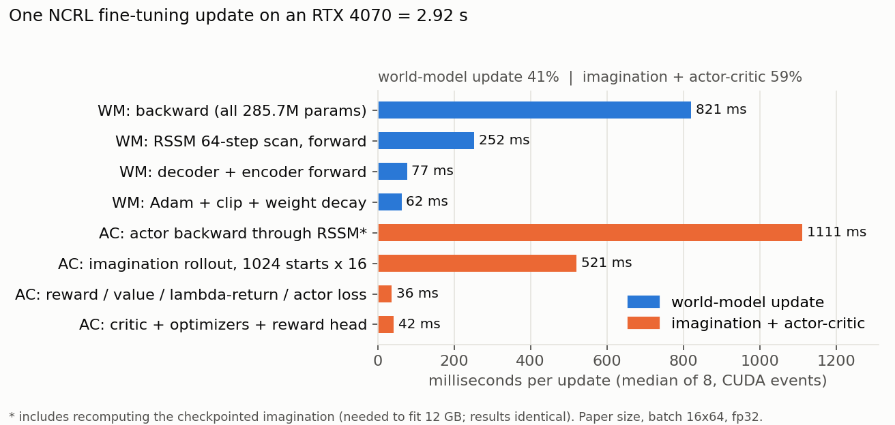
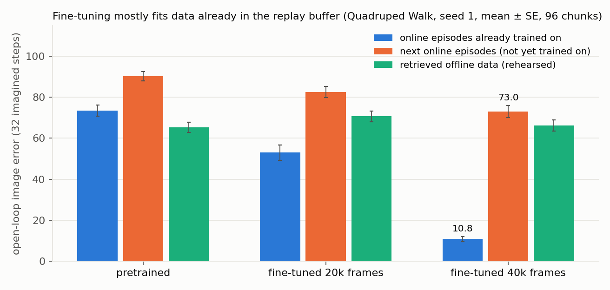
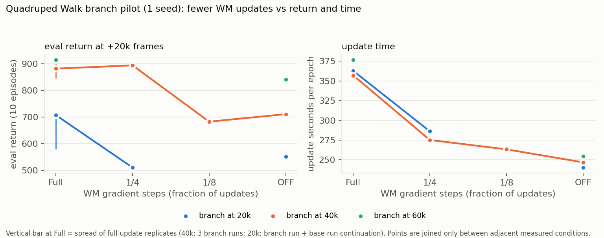

# NCRL-Light

**사전학습된 World Model을 새 task에 fine-tuning할 때, 어떤 계산이 불필요하게 반복되는가?**

*Finding and removing unnecessary computation when fine-tuning a pretrained world model (NCRL, ICLR 2026) on a single 12 GB GPU.*

> 상태: **진행 중** (2026-10-25). 계산 분석과 world model 진단은 완료. return 수준의 검증(분기 파일럿)은 진행 중이며 seed 1개 결과다. 이 README의 수치는 모두 RTX 4070 12GB에서 직접 측정한 값이고, 추정치는 따로 표시한다.

---

## TL;DR

| | 결과 | 근거 수준 |
|---|---|---|
| 1 | 학습 wall-clock의 **99%가 업데이트**다. 환경 수집은 1%다 | 측정 |
| 2 | 업데이트 1회 2.92초 = **world model(WM) 41% + 상상·actor-critic 59%** | 측정 |
| 3 | WM 업데이트를 통째로 빼도 업데이트 시간은 **최대 −32%**. 상상 시작점을 만드는 forward가 남기 때문이다 | 측정 |
| 4 | encoder·decoder freeze는 WM 시간 −4~9%로 실익이 적다. 논문 Fig. 8도 처음부터 모듈을 얼리면 학습이 크게 느려진다고 보고한다 | 측정 + 논문 |
| 5 | fine-tuning된 WM의 오차는 **이미 학습한 에피소드 10.8 vs 다음 에피소드 73.0**(사전학습 모델 90.3). 업데이트의 상당 부분이 리플레이 버퍼를 맞추는 데 쓰인다 | 측정 (seed 1) |
| 6 | 40k frame 이후 **WM 업데이트를 1/4로 줄이면** 업데이트 시간 −23%, 평가 return 895(원본 3회 846–914 범위 안). **1/8부터는 손실 신호**가 있다(683, OFF 711). 손실은 약 10k frame 늦게 나타난다 | **파일럿, seed 1** |
| 7 | 원본 설정(285.7M WM)을 **알고리즘 변경 없이 12GB에서** 돌릴 수 있다. 상상 rollout의 step 단위 checkpointing만 추가하며, 결과는 비트 단위로 동일하다 | 측정 |

**지금 가장 유망한 방향:** "어떤 모듈을 업데이트할지"보다 **"언제 WM을 업데이트할지"**다. 계산 절감 상한이 가장 큰 곳은 **상상 시작점 수**(업데이트 시간의 59%)다.

---

## 1. 배경

[NCRL](https://arxiv.org/abs/2502.19544)(Zhao et al., ICLR 2026)은 reward가 없고 품질도 섞인 다중 embodiment 오프라인 데이터로 대형 RSSM world model(285.7M 파라미터, DreamerV3 `size400m`과 같은 크기)을 사전학습한다. 새 task에서는 다음 방식으로 fine-tuning한다.

- **Experience retrieval**: 첫 프레임 임베딩으로 오프라인 데이터의 top-500 에피소드를 검색
- **Rehearsal**: 매 배치 16개 chunk 중 4개를 검색 데이터로 채움
- **Execution guidance**: 검색 데이터로 BC 정책을 학습하고, 학습 초기 에피소드의 일부 구간을 그 정책이 대신 행동

fine-tuning 1회에 논문 기준 약 8 GPU-h(MI250X), 우리 4070에서는 15–17시간이 걸린다. 매 업데이트마다 **285.7M 파라미터 전체를 학습**하고 **1024개 시작점에서 16 step씩 상상**한다.

**연구 질문:** 사전학습된 지식이 새 task에서도 상당 부분 유효하다면, 그 지식을 매번 다시 학습하는 것은 낭비가 아닐까? 어떤 계산이 불필요하고, 무엇을 줄여야 성능을 유지할 수 있는가?

## 2. 계산은 어디에 쓰이나



- **FLOPs와 시간의 순위가 다르다.** FLOPs로는 상상·AC(약 13.6 TFLOP)가 WM 업데이트(3.45 TFLOP)의 4배다. 그런데 시간은 비슷하다.
  - WM 학습은 **배치 16짜리 64단계 순차 RSSM scan**이다. 매 step마다 0.84 GB의 가중치를 다시 읽으므로 대역폭에 묶인다(달성 2.9 TFLOP/s).
  - 상상은 1024행을 병렬로 처리하므로 연산에 묶인다(약 11.5 TFLOP/s). → FLOPs 절감이 곧 시간 절감은 아니다.
- **모듈을 얼렸을 때 WM 업데이트 시간** (원본 1208 ms 기준):

  | 구성 | ms | 절감 |
  |---|---:|---:|
  | encoder freeze | 1152 | −5% |
  | decoder freeze | 1163 | −4% |
  | encoder + decoder freeze | 1100 | −9% |
  | RSSM GRU core freeze | 795 | −34% |
  | WM 업데이트 없음 (상상 시작점용 forward만) | 274 | −77% |

자세한 내용: [computation_analysis.md](computation_analysis.md)

## 3. WM 업데이트는 무엇을 배우나



Quadruped Walk 원본 실행의 20k·40k frame 스냅샷으로 forward만 수행해 진단했다.

- **암기**: 40k 시점 WM은 이미 학습한 online 에피소드에서 오차가 사전학습 대비 1/7로 줄었다. 그러나 **바로 다음 에피소드에서는 19%만** 줄었다. online 전이 하나는 평균 약 144번 재생된다.
- **rehearsal은 유지만 한다**: 검색 데이터의 오차는 변하지 않았다(65 → 66).
- **다른 embodiment는 잊는다**: cartpole 복원 오차 0.66 → 31.6. 목표 task에는 무관한 지식이다.
- **모듈 되돌리기**: 40k 모델에서 encoder + decoder만 사전학습 값으로 되돌려도 새 데이터의 동역학 오차는 +3%에 그쳤다. 새 데이터에 대한 일반화 이득은 주로 RSSM(GRU)에서 온다.

## 4. 분기 파일럿: WM 업데이트를 줄이면 return이 떨어지는가



**설계**
- 처음부터 학습(1회 15시간)하는 대신, 저장된 학습 상태에서 **분기**한다. 저장된 상태에는 모든 파라미터, Adam 상태 3개, BC 정책, 카운터, 리플레이 목록이 들어 있다.
- 각 arm은 20 epoch(+20k frame) 동안 **WM 업데이트 횟수만** 바꾼다. env step, actor-critic 업데이트(2500회), 상상 시작점(1024)은 모두 원본과 같다.
- 분기 시점: 20k / 40k / 60k frame. 목적은 WM 업데이트를 멈췄을 때의 손실이 학습 시점에 따라 달라지는지 확인하는 것이다.

**40k에서 분기한 결과 (seed 1, 원본 반복 3회)**

| 조건 | WM 업데이트 | eval 50k | eval 60k | AUC | 최종 손실 | 업데이트 시간/epoch |
|---|---:|---:|---:|---:|---:|---:|
| Full ×3 | 2500 | 806 | **882** (846/914/887) | 769 | — | 357 s |
| **Every4** | 625 | 882 | **895** | 810 | +12 | 275 s (**−23%**) |
| Every8 | 313 | 770 | **683** | 701 | −199 | 263 s (−26%) |
| OFF † | 0 | 759 | **711** | 702 | −171 | 247 s (−31%) |

† gradient 업데이트는 0회지만, NCRL 옵티마이저의 reward-head 단계 weight decay로 WM이 0.25% 줄었다. 20k·60k의 OFF arm은 `--strict_off`로 WM을 비트 단위로 고정했다.

- 성능은 WM 빈도에 대해 완만하게 줄지 않았다. 1/4는 원본 수준이고, 1/8은 OFF와 비슷하게 떨어졌다. 1/4 → 1/8로 얻는 시간은 3%p뿐이다.
- 1/8과 OFF(40k), OFF(60k) 모두 +10k에서는 원본과 비슷하다가 +20k에서 떨어졌다. 손실이 **늦게** 나타난다.
- 20k 분기는 원본끼리도 580–707로 흔들려서 판단할 수 없다. 60k OFF는 −73이지만, 원본이 이미 정체된 구간이다.
- 학습 중 return은 guidance 구간 때문에 차이를 보여 주지 못한다. 판단은 eval로 한다.
- 정리: [results/freq_summary_20261025.md](results/freq_summary_20261025.md) · 전체 표: [results/freq_comparison.md](results/freq_comparison.md), [results/pilot_summary.md](results/pilot_summary.md) · 판정 규칙(결과 전에 기록): [experiment_plan.md](experiment_plan.md) §3

## 5. 12GB에서 원본 그대로 돌리기

- **OOM의 유일한 원인은 상상 단계**다. `actor_grad=dynamics`라서 16 step 상상의 RSSM activation을 모두 저장해야 하고, 시작점 1024개면 +13.7 GiB가 필요하다.
- [`probe/ckpt_patch.py`](probe/ckpt_patch.py)는 상상의 각 step을 RNG를 보존하는 `torch.utils.checkpoint`로 감싼다.
  - NCRL 저장소 파일은 수정하지 않고, import 시점에 메서드만 교체한다.
  - 피크 메모리 8.9 GiB, 업데이트당 +0.55초.
  - actor/critic의 loss, gradient, 파라미터 차이가 **0.0**이다([`probe/equiv_paper_arch.json`](probe/equiv_paper_arch.json)).
- 배치·시퀀스 축소, fp16, 모듈 freeze는 필요 없다. 이것들은 알고리즘이나 수치를 바꾼다. fp16은 오히려 상상 메모리를 늘린다(시작점당 35 MiB vs 13.6 MiB).

자세한 내용: [hardware_feasibility.md](hardware_feasibility.md)

## 6. 코드에서 발견한 것

- **action padding 미적용**: `nets.py`의 `GaussianPolicy`에서 샘플에 mask를 적용하는 줄이 오타(`sampe = ...`)다. 그래서 학습 중 행동과 상상에서 RSSM이 패딩 차원(DMC 12–20, Meta-World 4–20)에 0이 아닌 값을 받고, actor는 env에 전달되지도 않는 그 차원으로 gradient를 받는다.
  - Quadruped에서의 영향은 상상 return +0.47%로 작다.
  - Meta-World는 패딩이 17차원이라 영향이 더 클 수 있다(미측정).
- **논문과 코드의 불일치**:
  - Table 6의 deter/hidden 값이 서로 바뀌어 있다.
  - 사전학습 배치: 16(논문) vs 32(스크립트).
  - Meta-World guidance schedule이 인자 4개로 적혀 있어 코드로 파싱할 수 없다.
  - 저장소의 기본 schedule이 논문 값과 다르다.
- NCRL WM에는 **continuation head가 없다**(상수 discount). 그래서 "continuation predictor freeze" 실험은 대상이 없다.

자세한 내용: [architecture_analysis.md](architecture_analysis.md)

## 7. 기존 연구와의 관계

| 연구 | 하는 일 | 이 연구와의 차이 |
|---|---|---|
| [DUTD](https://arxiv.org/abs/2303.10144) (ICLR'23) | validation loss로 update-to-data 비율 조절 | 목표가 성능이고, DreamerV2를 처음부터 학습한다. 별도 env step으로 validation 데이터를 모은다. **우리 baseline 후보** |
| [AdaWM](https://arxiv.org/abs/2501.13072) (ICLR'25) | 정책과 모델 중 불일치가 큰 쪽만 LoRA로 갱신 | 주행 도메인이고, 계산 절감은 측정하지 않는다 |
| SEER (NeurIPS'21), Smaller WMs (2023) | 고정 스케줄로 encoder를 동결하거나 덜 업데이트 | 수동 스케줄, 소형 모델 |
| [Selective Backprop](https://arxiv.org/abs/1910.00762) (2019) | loss가 작은 표본의 backward 생략 | 지도학습이다. 대역폭에 묶인 RNN scan에서는 시간 절감이 작을 것으로 예상(측정 예정) |
| [VaGraM](https://arxiv.org/abs/2204.01464) (ICLR'22) | value gradient로 모델 loss 가중 | loss 가중일 뿐, "계산할지 말지"를 판단하지 않는다 |
| [WISE](https://arxiv.org/abs/2609.03681) (2026) | 상상할 상태 선택 | VLA 사후학습이다(원문 미검토) |

**새로울 수 있는 지점:**
1. 사전학습된 대형 WM + rehearsal 환경에서
2. WM 업데이트를 AC 업데이트와 분리하고
3. 추가 env step 없이 판단하며
4. wall-clock과 return을 함께 측정하는 것

NCRL은 epoch마다 에피소드를 하나 모은 뒤에 업데이트하므로, **방금 수집한 에피소드는 자동으로 held-out이 된다.** 이를 업데이트 필요성 신호로 쓸 수 있다.

자세한 내용: [research_hypotheses.md](research_hypotheses.md)

## 8. 레포 구조

```
ncrl_light/
├── README.md
├── architecture_analysis.md     # 모듈별 역할·파라미터·업데이트 여부·freeze 가능성
├── computation_analysis.md      # 단계별 시간·FLOPs·메모리, freeze 표, WM 오차 진단
├── hardware_feasibility.md      # 12GB에서 원본 설정 실행
├── research_hypotheses.md       # 가설 H1–H6, 선행연구 대조, research gap
├── experiment_plan.md           # 지표, 실행 기록, 판정 규칙, 다음 실험
├── docs/figures/                # README 그림 (tools/make_figures.py)
├── tools/
│   ├── profile_update.py        # 업데이트 단계별 시간·FLOPs·freeze 표
│   ├── profile_variants.py      # 배치·시퀀스·정밀도별 시간·메모리
│   ├── diag_wm_error.py         # seen/unseen 오차, drift, 모듈 되돌리기
│   ├── padded_action_probe.py   # action padding 영향
│   ├── branch_selective.py      # 분기: WM 빈도·freeze·strict off·상태 저장·초기 평가
│   ├── test_branch_selective.py # CPU 테스트
│   ├── summarize_pilot.py       # 분기 결과 표
│   └── make_figures.py
├── probe/                       # 이전 단계 도구 사본 (원본: ~/RL/ncrl_probe)
│   ├── ckpt_patch.py            # 결과 동일 메모리 절약 패치
│   ├── run_ncrl.py              # 원본 학습 + 전체 상태 스냅샷
│   ├── branch_ncrl.py           # 저장 상태에서 분기
│   ├── equiv_test2.py           # 패치 동등성 테스트
│   └── prep_db.py, bench_update.py
├── results/                     # 측정 JSON·로그·중간 보고
└── runs/branch40k/              # 분기 파일럿 (큐, arm별 로그; 리플레이 버퍼는 제외)
```

## 9. 재현

**환경**: Ubuntu 22.04, RTX 4070 12GB, conda env `ncrl_env`(Python 3.10, PyTorch 2.13 + CUDA 13.0), NCRL 저장소의 `environment.yaml` 기준.

```bash
# 1) NCRL 원본 코드 (수정하지 않음)
git clone https://github.com/zhaoyi11/ncrl ~/RL/ncrl_src
# 2) 사전학습 모델 + 데이터: https://huggingface.co/datasets/zhaoyi11/ncrl  (models.zip 2.1 GB, datasets 19 GB)
#    -> ~/RL/ncrl_data/models/models/{dmcontrol,metaworld}.pt, ~/RL/ncrl_data/ncrl_datasets/
# 3) 검색 DB (원본 스크립트는 RAM 60 GB 이상을 쓰므로 대체 스크립트 사용)
python -I probe/prep_db.py --ncrl ~/RL/ncrl_src --model-basedir ~/RL/ncrl_data/models/models \
    --data-basedir ~/RL/ncrl_data/ncrl_datasets --benchmarks dmcontrol --out ~/RL/ncrl_data/dataset_db_dmc.npz
```

```bash
export MUJOCO_GL=egl PYTORCH_CUDA_ALLOC_CONF=expandable_segments:True
cd tools
python -I profile_update.py --out ../results/profile_update.json      # 계산 분석 (~6분)
python -I diag_wm_error.py  --out ../results/diag_wm_error.json       # WM 진단 (~5분, 원본 실행 스냅샷 필요)
python -I branch_selective.py --wm_every 4 -- --base_run <run> --snapshot <run>/snapshot_40000.full.pt --out wm_every4 --epochs 20
python3 summarize_pilot.py && python -I make_figures.py
```

주의: 스크립트에는 이 머신 기준의 절대경로(`/home/yeho/RL/...`)가 들어 있다. NCRL 코드 위치는 `NCRL_SRC` 환경변수로 바꿀 수 있다. 원본 실행의 정확한 인자는 [hardware_feasibility.md](hardware_feasibility.md) §6에 있다.

## 10. 한계

- **seed 수**: 분기 파일럿은 base run 1개(seed 1)와 분기 seed 1개다. 같은 설정끼리의 흔들림이 효과 크기와 비슷하다.
- **task 수**: 지금까지는 Quadruped Walk뿐이다. Quadruped Walk는 NCRL이 빠르게 푸는 쉬운 task다. Meta-World 성능 재현은 아직 확인하지 못했다.
- **계산 절감 상한**: WM만 줄이면 최대 32%(4070) / 약 40%(recompute가 없는 환경, 추정)다.
- **사후 분석의 해석**: 모듈 되돌리기와 오차 진단은 학습 궤적을 바꾼 실험이 아니다.

## 참고

```bibtex
@inproceedings{zhaoefficient,
  title     = {Efficient Reinforcement Learning by Guiding World Models with Non-Curated Data},
  author    = {Zhao, Yi and Scannell, Aidan and Zhao, Wenshuai and Hou, Yuxin and Cui, Tianyu and Chen, Le and B{\"u}chler, Dieter and Solin, Arno and Kannala, Juho and Pajarinen, Joni},
  booktitle = {The Fourteenth International Conference on Learning Representations},
  year      = {2026}
}
```

이 레포는 NCRL 소스코드를 포함하지 않는다. `probe/`와 `tools/`의 스크립트는 NCRL 클래스를 import한 뒤 일부 메서드를 실행 시점에 교체한다. NCRL은 Apache-2.0 라이선스다.
